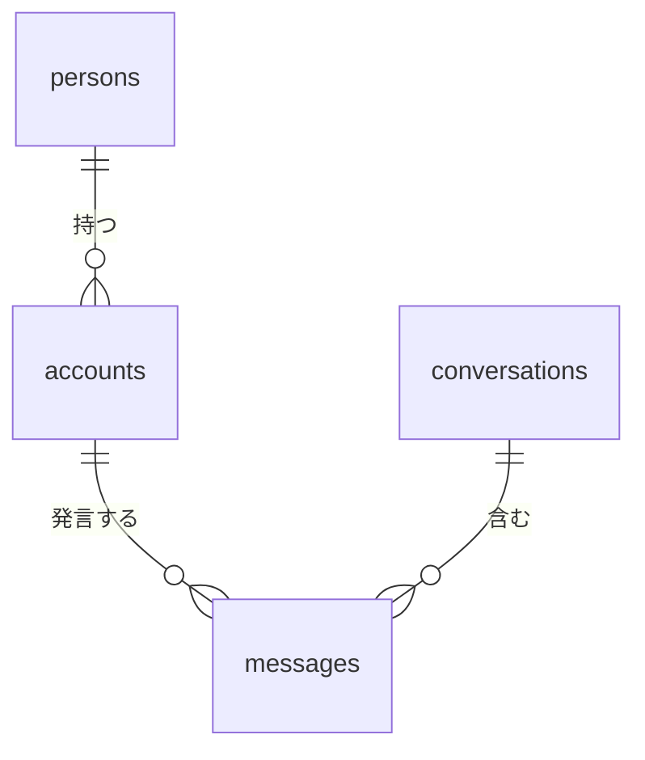
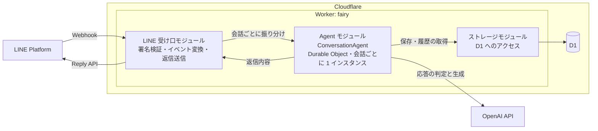
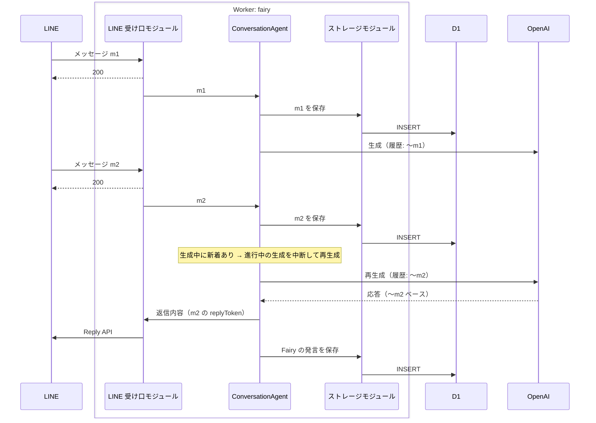

# Fairy 設計書

シカコ区3番街の自宅に「住まわせる」AI アシスタント **Fairy** の設計書。

> 凡例
> - 印なし … 決定事項。MVP に限らず、将来を見据えた判断
> - **[MVP]** … MVP として暫定的に決めていること。後のフェーズで見直す前提
> - **[未決]** … まだ決めていないこと（MVP では不要なため後回しにしているものを含む）
>
> **但し書き**: 決定事項は「現時点での合意」を意味し、永久に固定するものではない。開発を進める中で前提や判断が変われば見直す。見直したときは本書を更新し、変更の理由を残す。

---

## 1. 背景・コンセプト

- ゲーム「ゼンレスゾーンゼロ」で主人公パエトーンの自称・筆頭助手を務める AI「Fairy」をモチーフにした家庭用 AI アシスタント。
- 作中で Fairy たちは「新エリー都ヤヌス区六分街」に住んでいる。これにならい、オーナーの住所をもじって「シカコ区3番街 (sicaco-quarter-third-street)」と名付けた。
- 口調・性格などのキャラクター設定はこの設計書には書かず、`FAIRY.md` で管理する。

## 2. 目標とスコープ

### 2.1 最終的に実現したいこと

| 領域 | 内容 |
| --- | --- |
| 話し相手 | 同居人のように日常会話をする |
| スマートホーム操作 | 家電の操作・状態の確認 |
| 生活サポート | 情報提供・リマインド・見守り・記録 |

| やり取りの手段 | 内容 |
| --- | --- |
| 音声 | 自宅に固定した iPad のマイク・スピーカー |
| LINE | 家族グループでのやり取りと、マスター・助手二号との DM |
| 専用インターフェース | iPad や私物スマホで使う専用 UI |
| 自発的な話しかけ | Fairy の側から通知・声かけをする |

- 機能もやり取りの手段も **段階的に** 増やしていく。
- 最終的には、画像なども含めてあらゆる投稿を理解できるようにする（反応するかどうかは内容次第）。

### 2.2 利用者

- 現在は大人 2 人。将来 3 人以上に増える可能性がある。
- 人ごとに識別し、人ごとに記憶や予定を分ける。

### 2.3 制約

| 項目 | 内容 |
| --- | --- |
| 言語 | TypeScript |
| 実行環境 | 最初は Cloudflare Workers を使う。クラウドを使うときは Cloudflare の製品を前提にする。ローカル環境（Local LLM など）を使う可能性もゼロではないが、将来大きな負債にならない限り Cloudflare Workers を優先する |
| LLM | OpenAI のできるだけ安いモデル。機能上もっと高性能なモデルが必要な場合は相談して決める |
| 運用コスト | 月 2,000 円程度まで（Cloudflare / OpenAI / LINE の合計） |
| LINE | Messaging API の公式アカウントは作成済み |

## 3. フェーズ計画

| フェーズ | 内容 | 取り組みやすい理由・前提 |
| --- | --- | --- |
| Phase 1 (MVP) | LINE（家族グループ + マスター・助手二号との DM）でテキストとスタンプの会話。短期記憶のみ | — |
| Phase 2 (暫定) | LINE の画像の理解 | 既存の LINE の経路に、画像の取得と画像を扱えるモデルの呼び出しを足すだけで済む |
| Phase 3 (暫定) | 長期記憶（人ごとの好み・出来事などを覚える） | 外部連携が要らない。Phase 1 から保存している会話ログを素材にできる |
| Phase 4 (暫定) | 情報提供・リマインド（天気・予定・ゴミの日など）を LINE で自発的に送る | Cron Triggers と LINE Push API で作れる。Push の無料通数の上限への対応が必要 |
| Phase 5 (暫定) | 専用 UI（iPad / スマホで使う Web アプリ。テキストでの会話） | Cloudflare 上で完結する。**2 つ目のプラットフォームになるので、環境をまたいだ同一人物の判定もここで実装する** |
| Phase 6 (暫定) | iPad での音声のやり取り | Phase 5 の UI に音声入出力 (STT / TTS) を足す。ブラウザでの常時待ち受けなど検証項目が多い |
| Phase 7 (暫定) | 音声での自発的な話しかけ | Phase 4 と Phase 6 の組み合わせ |
| Phase 8 (暫定) | スマートホーム操作 | 自宅 LAN 内の機器につなぐ仕組み（Tunnel・自宅に置くマシンなど）が必要。構成がまだ決まっていない |
| Phase 9 (暫定) | 見守り・記録（在室状況・センサー情報など） | Phase 8 の仕組みとセンサー機器が前提 |

## 4. 人の識別モデル

Fairy は LINE などのアカウントではなく **「人間」** を識別する。

- LINE では `userId` や表示名などを手がかりに「この人間は誰か」を識別する。
- 音声や専用 UI など、ほかの環境でも同じように「この人間は誰か」を識別する。
- 別々の環境にいる人が同一人物かどうかは **会話の流れから Fairy が判断し、記憶する**。
- ただし **「誰がマスターで、誰が助手二号か」** だけは特別な情報として、設定ファイルまたは `FAIRY.md` に固定値で持たせる。

### 4.1 概念モデル

- **Person（人間）**: Fairy が識別する 1 人の人間。
- **Account（アカウント）**: ある環境（プラットフォーム）での利用者のアカウント。LINE の 1 ユーザー、専用 UI のログインユーザーなどが該当する。1 人の Person が複数の Account を持つ。
- **Platform（プラットフォーム）**: Fairy とやり取りする環境の種類。`line` / `web`（専用 UI）/ `voice`（iPad の音声）など。
  - LINE 以外のプラットフォームで「アカウント」を何で表すか（専用 UI のログイン ID、音声なら端末や声紋など）は、そのプラットフォームを追加するフェーズで決める。**[未決]**

- MVP では LINE だけなので、Account を作るときに Person も 1 対 1 で自動作成する。**[MVP]**
- 環境をまたいだ紐付け（複数の Account を 1 人の Person にまとめること）は、2 つ目のプラットフォームを追加する Phase 5 で実装する。
- マスターと助手二号は、設定値に書いた LINE `userId` をもとに Person の `role` に反映する（5.6 参照）。

## 5. Phase 1 (MVP) の詳細設計

### 5.1 要件

- Fairy は LINE の **家族グループ** に参加する。
- **DM（1:1 トーク）はマスターと助手二号とだけ行う**。それ以外の人からの DM には応答しない。
- 家族グループ以外のグループに招待されても、MVP では退出はせず **応答しないだけ** にする。**[MVP]** **将来ほかのグループでも会話できるよう拡張の余地を残す**。
- 会話に投稿された **すべてのメッセージを LLM で判定し**、応答が必要なときだけ返信する。
- 家族同士のやり取りも保存し、文脈として参照してよい。
- 扱う入力はテキストとスタンプ。**[MVP]**
- 記憶は短期（直近の会話履歴）のみ。**[MVP]** ただし長期記憶を後から追加できる構造にしておく。
- 会話ログは **無期限で保存** する（将来の長期記憶の素材にする）。
- Fairy の回答が完了する前に新しいメッセージが届いたら、**そのメッセージも踏まえて回答する**。

### 5.2 構成

| 要素 | 役割 |
| --- | --- |
| Worker (`fairy`) | デプロイ単位。以下のモジュールを含む |
| └ LINE 受け口モジュール | Webhook の受け口。署名 (`x-line-signature`) を検証し、すぐに 200 を返す。会話を受け付けるかどうかを判定し、イベントを会話ごとの ConversationAgent に渡す。Agent が作った返信を Reply API で送る |
| └ Agent モジュール (`ConversationAgent`) | Agents SDK の Agent クラス（Durable Object）。会話（グループや DM）ごとに 1 インスタンス。その会話の処理を直列化し、「回答の生成中に新しいメッセージが届いた」ことを検知する（5.4 参照） |
| └ ストレージモジュール | D1 への読み書きをまとめる |
| D1 | Person / Account / 会話 / メッセージを保存する |
| Workers Secrets | LINE の Channel Secret / Access Token、OpenAI API Key |
| 環境変数 | 固定の設定値（5.6） |

- 返信は Reply API を使う。Push API は無料で送れる通数に上限があるため、MVP では使わない。**[MVP]**
- Durable Objects は無料プランでも SQLite バックエンドのものが使える認識だが、要確認。使えなくても Workers Paid（月 $5）なら予算内に収まる。

#### Durable Object を使う理由

**実現したいこと**: 同じ会話の中で、「回答の生成中に新しいメッセージが届いたら、進行中の生成を止め、最新の履歴で生成し直す」こと。

**Worker だけでは難しい理由**: Webhook は 1 回ごとに独立したリクエストとして処理され、リクエスト同士でメモリを共有できない。m2 を処理しているリクエストからは、m1 を処理しているリクエストの存在も、その LLM 呼び出しも見えない。D1 にフラグを書いてポーリングする方法も考えられるが、ロックの競合や遅延の扱いが複雑になる。

**Durable Object が有用な点**:

| 特徴 | この設計での使い道 |
| --- | --- |
| ID ごとに世界で 1 つのインスタンスになる | 会話（groupId / DM の userId）ごとに 1 つにすれば、同じ会話のイベントが必ず同じ場所に集まる |
| インスタンスがメモリ上の状態を持てる | 「生成中かどうか」「最後に受け取ったメッセージ」「進行中のリクエストの `AbortController`」を持てるので、新着が来たらその場で中断・再生成できる |
| 処理が直列化される | 同じ会話で複数の返信が同時に作られて競合することがない |
| （将来）Alarms / WebSocket | 自発的な話しかけのタイマー（Phase 4）、iPad の専用 UI との常時接続（Phase 5〜7）にも使える |

#### プラットフォームの受け口と Agent をコード上で分離する

Fairy を AI Agent として育てていくと、LINE・専用 UI・音声のどこから話しかけられても、同じ「頭脳」（プロンプトの組み立て、LLM 呼び出し、記憶、ツール実行）が使われる必要がある。そのため、コード上で次の 2 つの層を分ける。

| 層 | 役割 |
| --- | --- |
| プラットフォームの受け口 | プラットフォーム固有の処理（LINE なら署名検証・イベントの変換・Reply API での送信） |
| Agent | プラットフォームに依存しない会話処理（履歴・プロンプト・LLM・再生成の制御）。Durable Object `ConversationAgent` |

- デプロイ単位は **1 つの Worker（`fairy`）** にする。Worker を分けても、家庭用の規模では独立デプロイ・個別スケールなどの具体的なメリットがないため。分ける必要が出てきたら、そのときに切り出す（Durable Object は別 Worker からもバインディングで呼べる）。
- プラットフォームが増えたら、受け口のモジュールを足す（例: `/webhook/line`、`/ws` などのルート）。Worker の名前は特定のプラットフォームを表さない `fairy` にしておく。
- Agent は返信の送り方を知らない。返信の送信（Reply API / Push API / WebSocket など）はプラットフォームごとのモジュールが担う。

#### Agent フレームワークとして Cloudflare Agents SDK を最初から最小限使う

MVP 自体は OpenAI の SDK だけでも作れるが、機能追加（MCP によるツール連携、リマインドのスケジュール実行、専用 UI との常時接続）のときにはほぼ確実にフレームワークが必要になる。後から載せ替えるより、最初から最小限使っておく。

候補と比較（2026-11 時点の公開情報で確認）:

| 観点 | Cloudflare Agents SDK (`agents`) | Mastra |
| --- | --- | --- |
| Durable Object との関係 | Agent クラス自体が Durable Object。本設計の `ConversationAgent` をそのまま Agent クラスで作れる（参考: [Agent class internals](https://developers.cloudflare.com/agents/concepts/agent-class/)） | Durable Object は主にストレージのアダプター（`CloudflareDOStorage`）として使う（参考: [Mastra: Cloudflare Storage](https://mastra.ai/reference/storage/cloudflare)、[Mastra Changelog 2026-03-12](https://mastra.ai/blog/changelog-2026-03-12)） |
| MCP | MCP クライアント機能を内蔵（HTTP / Workers RPC で接続。MCP 2026-07-28 仕様に対応）（参考: [MCP Client API](https://developers.cloudflare.com/agents/model-context-protocol/apis/client-api/)、[Agents SDK v0.6.0](https://developers.cloudflare.com/changelog/post/2026-02-25-agents-sdk-v0.6.0/)、[MCP 2026-07-28 対応](https://community.cloudflare.com/t/agents-workers-agents-sdk-adds-mcp-specification-2026-07-28-support/943386)） | MCP クライアント機能あり |
| 将来の機能 | スケジュール実行（Phase 4）、WebSocket・状態同期（Phase 5〜7）（参考: [cloudflare/agents (GitHub)](https://github.com/cloudflare/agents)） | ワークフロー・メモリ・評価などの機能が豊富 |
| 本設計との相性 | 「生成中の新着で中断・再生成」を Durable Object 上で自前制御する設計とそのまま噛み合う | Mastra 側の Agent 実行・メモリ管理と、自前の制御との合わせ込みが必要 |

- **Cloudflare Agents SDK を採用し、MVP では `ConversationAgent` を Agent クラスで作るところまでにとどめる**。**[MVP]**MCP・スケジュールなどは使う機能が必要になったフェーズで使い始める。
- LLM の呼び出しは OpenAI の SDK（または Agents SDK と組み合わせやすい SDK）を使う。具体的な組み合わせは実装の最初に確認する。（参考: [Building agents with OpenAI and Cloudflare's Agents SDK](https://blog.cloudflare.com/building-agents-with-openai-and-cloudflares-agents-sdk/)）

### 5.3 処理フロー（LINE 受け口モジュール）

1. Webhook を受け取って署名を検証し、すぐに 200 を返す（以降の処理は `ctx.waitUntil` で行う）。
2. 会話を受け付けるかどうかを判定する（5.5）。受け付けない会話は破棄する。
3. 会話の ID（groupId または DM 相手の userId）に対応する Durable Object にイベントを渡す。

### 5.4 処理フロー（ConversationAgent）

#### 基本の流れ

1. **送信者の Account / Person を解決する**。D1 になければその場で作成する（表示名はプロフィール API で取得する）。
2. **受信したメッセージを D1 に保存する**。スタンプは `packageId` / `stickerId` と、Webhook に含まれる場合は `keywords` を保存し、LLM にはキーワードをテキストとして渡す。
3. 直近 N 件の会話履歴・`FAIRY.md`・人の情報からプロンプトを作る。
4. LLM に **応答の要否と応答文を 1 回の呼び出しで** 出力させる（Structured Outputs、例: `{ should_reply: boolean, reply: string }`）。判定と生成を別々に呼ぶより呼び出し回数が少なく、コストを抑えられる。
5. `should_reply` が true なら、返信内容を LINE 受け口モジュールに渡して Reply API で送ってもらい、Fairy の発言を D1 に保存する。

#### 生成中に新しいメッセージが届いた場合

ConversationAgent は「生成中かどうか」と「最後に受け取ったメッセージ」を記録している。生成中に新しいメッセージが届いたら、**進行中の生成を中断し、最新の履歴で生成し直す**。

- 返信には **最新のメッセージの replyToken** を使う（replyToken はメッセージイベントごとに発行される）。
- 中断は、進行中の OpenAI へのリクエストを `AbortController` で止めて行う。応答を待ってから捨てるより待ち時間が短い。
- 再生成の回数の上限は設定値 `MAX_REGENERATIONS` で変えられるようにし、初期値は **10** とする。**[MVP]** 上限に達したら、その時点の応答で返信する。
  - 再生成のきっかけは常に新着メッセージなので、返信に使う replyToken は「最後のメッセージを受け取ってから 1 回分の生成時間」しか経っていない。そのため、再生成が続いても replyToken が古くなることはない。
- 再生成した分だけ OpenAI の費用が増える点に注意する。

#### 応答速度と D1 への保存のタイミング

応答速度への影響が最も大きいのは LLM の呼び出し（数秒）で、D1 への書き込みは数〜数十ミリ秒程度と見込んでいる。そのため次のようにする。

- **受信メッセージは LLM を呼ぶ前に保存する**。上の「生成中の新着」の検知と再生成には最新の履歴が必要なこと、LLM の呼び出しが失敗してもログが残ることが理由。
- **Fairy の発言は返信を送った後に保存する**（応答時間に影響しない）。
- 1 と 2（Account の解決とメッセージの保存）と履歴の取得は、並列にできる部分は並列に行う。
- さらに速くする必要が出てきたら、直近の履歴を Durable Object 内にキャッシュし、D1 からの読み出しを省く。

#### メッセージイベントだけを処理する **[MVP]**

MVP で処理する Webhook イベントはメッセージイベントだけで、join / memberJoined / leave / memberLeft などそれ以外のイベントは無視する。

- Person / Account は、メッセージを受信したときに「なければ作る」（基本の流れの 1）ので、最初に発言した時点で必ず登録される。一度も発言しない人は Fairy にとって識別する必要がない。
- 家族グループの groupId もメッセージイベントの `source.groupId` から分かる。

#### LLM のモデルと会話履歴の件数 **[MVP]**

| 項目 | 値 | 設定値 |
| --- | --- | --- |
| モデル | `gpt-6-luna` | `OPENAI_MODEL` |
| reasoning effort | `none`（応答速度とコストを優先。応答の質が足りなければ `low` に上げる） | `OPENAI_REASONING_EFFORT` |
| 会話履歴の件数 N | 30 件 | `HISTORY_LIMIT` |

**モデルを `gpt-6-luna` にする理由**（2026-11-22 時点の OpenAI 公式ページで確認。参考: [Pricing](https://developers.openai.com/api/docs/pricing)、[Models](https://developers.openai.com/api/docs/models)、[Deprecations](https://developers.openai.com/api/docs/deprecations)）

| モデル | 入力 / キャッシュ入力 / 出力（1M トークンあたり） | 状態 |
| --- | --- | --- |
| `gpt-5-nano` | $0.05 / $0.005 / $0.40 | 2026-12-11 に提供終了。後継は `gpt-6-luna` |
| **`gpt-6-luna`** | **$0.10 / $0.01 / $0.50** | 現行。OpenAI が「最も効率的なモデル」としている |
| `gpt-5.6-luna` | $0.20 / $0.02 / $1.20 | 現行 |
| `gpt-5.4-nano` | $0.20 / $0.02 / $1.25 | 2027-04-01 に提供終了 |

- 単価が最も安い `gpt-5-nano` は数週間後に提供終了するため、現行モデルで最も安い `gpt-6-luna` を選ぶ。
- 画像入力にも対応しているため、Phase 2（画像の理解）でもモデルを変えずに済む見込み。
- 要確認: Structured Outputs（JSON Schema 指定の出力）に対応しているかは、公式ページで明記を確認できていない。実装の最初に確かめる。

**コストの試算**（利用量は仮定）

- 1 回の呼び出し: 入力 約 4,000 トークン（`FAIRY.md` 約 2,000 + 履歴 30 件 約 1,500 + その他）、出力 約 150 トークンと仮定すると、約 $0.0005。
- 1 日 100 メッセージ（再生成を含む）なら、月 3,000 回で **約 $1.5（約 230 円）**。
- `FAIRY.md` などのプロンプトの先頭部分は毎回同じなので、キャッシュ入力の料金（通常の 1/10）が適用されれば、さらに安くなる。
- 予算（月 2,000 円）に対して十分に余裕がある。

**会話履歴を 30 件にする理由**

- グループでは複数人の発言が入り混じるため、1:1 より多めに必要になる。30 件あれば、数人で何往復かした話題をひと通り含められる。
- 日本語の短い発言なら 30 件で 1,000〜2,000 トークン程度で、コストへの影響は小さい。
- 運用しながら調整する前提で、設定値で変えられるようにする。

### 5.5 会話の受け付け判定

| 会話の種類 | 扱い |
| --- | --- |
| 家族グループ（設定値の groupId と一致） | 受け付ける |
| マスター・助手二号との DM | 受け付ける |
| それ以外の人との DM | 応答しない。保存もしない |
| 家族グループ以外のグループ | 退出はせず、応答しない。保存もしない。**[MVP]** 将来は `conversations` テーブルで受け付けるグループを管理できるようにする（管理方法は **[未決]**） |

### 5.6 固定の設定値

リポジトリには入れず、環境変数に置く。

| キー | 内容 |
| --- | --- |
| `LINE_MASTER_USER_ID` | マスターの LINE userId |
| `LINE_ASSISTANT2_USER_ID` | 助手二号の LINE userId |
| `LINE_FAMILY_GROUP_ID` | 家族グループの groupId。**[MVP]** 受け付けるグループを `conversations` テーブルで管理するようになったら不要になる |

### 5.7 FAIRY.md の取り込み

- `FAIRY.md` はリポジトリで管理し、ビルド時に文字列として Worker に取り込んでシステムプロンプトに使う。
- `FAIRY.md` 内の HTML コメント（`<!-- ... -->`）は、オーナーが内容の補足（出典・元のセリフなど）を書くためのもの。システムプロンプトに入れる前に取り除く。

### 5.8 データ（D1）

#### `persons`（人間）

| カラム | 型 | 説明 |
| --- | --- | --- |
| `id` | TEXT (PK) | Fairy の内部で使う Person の ID |
| `role` | TEXT NULL | `master` / `assistant2` / NULL。設定値から反映する |
| `name` | TEXT NULL | Fairy が会話を通じて覚えた呼び名 |
| `notes` | TEXT NULL | Fairy が覚えた情報。**[MVP]** 長期記憶を実装するまでの仮置き |
| `created_at` | TEXT | 作成日時 |
| `updated_at` | TEXT | 更新日時 |

#### `accounts`（アカウント）

| カラム | 型 | 説明 |
| --- | --- | --- |
| `id` | TEXT (PK) | Fairy の内部で使う Account の ID |
| `platform` | TEXT | `line` / `web` / `voice` など |
| `platform_user_id` | TEXT | **プラットフォーム側でのユーザーの ID**。LINE なら `userId`（`U` で始まる文字列）。`id` は Fairy の内部で使う ID で、こちらはプラットフォームから届く ID なので別物。`(platform, platform_user_id)` で一意 |
| `display_name` | TEXT NULL | プラットフォーム上の表示名（LINE のプロフィール名など） |
| `person_id` | TEXT (FK) | 紐付く Person |
| `linked_by` | TEXT | Person への紐付け方。`auto`（自動作成）/ `config`（設定値）/ `fairy_inference`（Fairy が会話から判断） |
| `created_at` | TEXT | 作成日時 |

#### `conversations`（会話の場）

| カラム | 型 | 説明 |
| --- | --- | --- |
| `id` | TEXT (PK) | Fairy の内部で使う会話の ID |
| `platform` | TEXT | `line` など |
| `platform_conversation_id` | TEXT | プラットフォーム側の会話の ID。LINE のグループなら `groupId`、DM なら相手の `userId` |
| `type` | TEXT | `group` / `dm` |
| `label` | TEXT NULL | `family` など、会話の場の用途 |
| `created_at` | TEXT | 作成日時 |

#### `messages`（メッセージ）

| カラム | 型 | 説明 |
| --- | --- | --- |
| `id` | TEXT (PK) | Fairy の内部で使うメッセージの ID |
| `conversation_id` | TEXT (FK) | どの会話の場のメッセージか |
| `account_id` | TEXT (FK) NULL | 発言者。Fairy 自身の発言は NULL |
| `type` | TEXT | `text` / `sticker` など |
| `text` | TEXT NULL | 本文。スタンプはキーワードを入れる |
| `payload_json` | TEXT | 元のイベント（将来の再解析に使う） |
| `platform_message_id` | TEXT NULL | プラットフォーム側のメッセージ ID（重複受信の検知に使う） |
| `created_at` | TEXT | 送信日時 |

## 6. 非機能要件

| 項目 | 方針 |
| --- | --- |
| コスト | 月 2,000 円以内。全メッセージを LLM で判定し、さらに再生成もあるため、OpenAI の使用量を監視する（監視方法は **[未決]**） |
| プライバシー | 家族の会話を無期限に保存する。保存先は Cloudflare D1 |

## 7. 未決事項

### 7.1 実装の最初に確認すること

- [ ] `gpt-6-luna` が Structured Outputs に対応しているか（5.4）
- [ ] Durable Objects を無料プランで使えるか（5.2）
- [ ] LLM の呼び出しに使う SDK の組み合わせ（5.2）

### 7.2 後のフェーズで決めること

- [ ] Phase 2 以降の内容と順番の確定（3 章は暫定）
- [ ] 長期記憶の方式（要約・ベクトル検索 (Vectorize) など）
- [ ] 自発的な話しかけで LINE Push API を使う場合の、無料通数の上限への対応
- [ ] iPad で音声をやり取りする方式（STT / TTS をどこで処理するか）
- [ ] スマートホーム機器の構成と、自宅 LAN 内の機器へのつなぎ方
- [ ] 環境をまたいで同一人物を判定するロジックの詳細
- [ ] LINE 以外のプラットフォームで「アカウント」を何で表すか
- [ ] 家族グループ以外のグループへの参加の可否と、その管理方法
- [ ] OpenAI の使用量の監視方法
