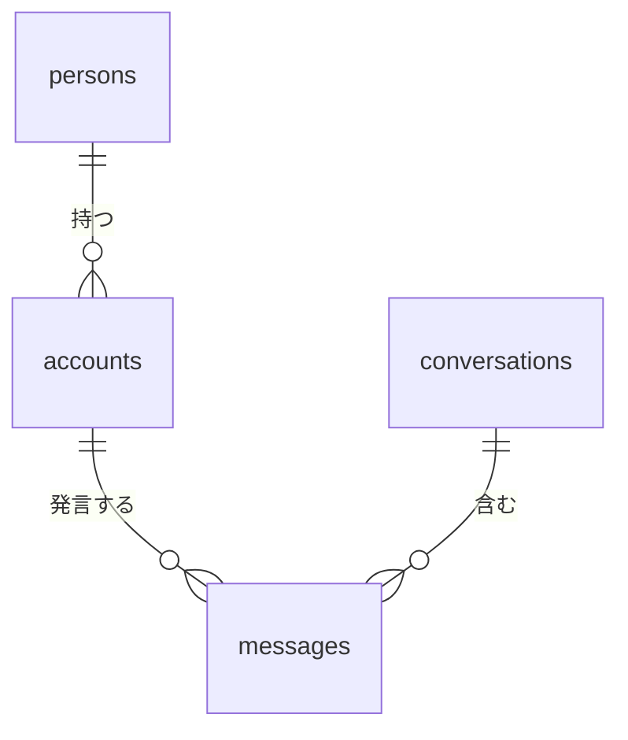

# 全体設計

## 人の識別モデル

Fairy は LINE などのアカウントではなく **「人間」** を識別する。

- LINE では `userId` や表示名などを手がかりに「この人間は誰か」を識別する。
- 音声や専用 UI など、ほかの環境でも同じように「この人間は誰か」を識別する。
- 別々の環境にいる人が同一人物かどうかは **会話の流れから Fairy が判断し、記憶する**。
- ただし **「誰がマスターで、誰が助手二号か」** だけは特別な情報として、固定値で持たせる（[設定値](phases/phase-1.md#設定値)）。

### 概念モデル

- **Person（人間）**: Fairy が識別する 1 人の人間。
- **Account（アカウント）**: ある環境（プラットフォーム）での利用者のアカウント。LINE の 1 ユーザー、専用 UI のログインユーザーなどが該当する。1 人の Person が複数の Account を持つ。
- **Platform（プラットフォーム）**: Fairy とやり取りする環境の種類。`line` / `web`（専用 UI）/ `voice`（iPad の音声）など。
  - LINE 以外のプラットフォームで「アカウント」を何で表すか（専用 UI のログイン ID、音声なら端末や声紋など）は、そのプラットフォームを追加するフェーズで決める。**[未決]**

テーブル定義は [データモデル](#データモデル) を参照。

- MVP では LINE だけなので、Account を作るときに Person も 1 対 1 で自動作成する。**[MVP]**
- 環境をまたいだ紐付け（複数の Account を 1 人の Person にまとめること）は、2 つ目のプラットフォームを追加する Phase 5 で実装する。
- マスターと助手二号の情報は設定値（[設定値](phases/phase-1.md#設定値)）だけを正とし、DB には持たない。発言者がマスターかどうかは、その都度「発言者の Person に紐付く Account の中に、設定値の LINE `userId` と一致するものがあるか」で判定する。
  - 同じ情報を DB にも持つと同期が必要になり、食い違う危険がある。
  - 役割は Person 単位で効くので、Phase 5 以降に別のプラットフォームの Account が同じ Person に紐付けば、その Account からの発言も自動的にマスターと判定される。

## 全体アーキテクチャ

### プラットフォームの受け口と Agent をコード上で分離する

Fairy を AI Agent として育てていくと、LINE・専用 UI・音声のどこから話しかけられても、同じ「頭脳」（プロンプトの組み立て、LLM 呼び出し、記憶、ツール実行）が使われる必要がある。そのため、コード上で次の 2 つの層を分ける。

| 層 | 役割 |
| --- | --- |
| プラットフォームの受け口 | プラットフォーム固有の処理（LINE なら署名検証・イベントの変換・Reply API での送信） |
| Agent | プラットフォームに依存しない会話処理（履歴・プロンプト・LLM・再生成の制御）。Durable Object `ConversationAgent` |

- デプロイ単位は **1 つの Worker（`fairy`）** にする。Worker を分けても、家庭用の規模では独立デプロイ・個別スケールなどの具体的なメリットがないため。分ける必要が出てきたら、そのときに切り出す（Durable Object は別 Worker からもバインディングで呼べる）。
- プラットフォームが増えたら、受け口のモジュールを足す（例: `/webhook/line`、`/ws` などのルート）。
- Agent は返信の送り方を知らない。返信の送信（Reply API / Push API / WebSocket など）はプラットフォームごとのモジュールが担う。

### Durable Object を使う理由

**実現したいこと**: 同じ会話の中で、「回答の生成中に新しいメッセージが届いたら、進行中の生成を止め、最新の履歴で生成し直す」こと。

**Worker だけでは難しい理由**: Webhook は 1 回ごとに独立したリクエストとして処理され、リクエスト同士でメモリを共有できない。m2 を処理しているリクエストからは、m1 を処理しているリクエストの存在も、その LLM 呼び出しも見えない。D1 にフラグを書いてポーリングする方法も考えられるが、ロックの競合や遅延の扱いが複雑になる。

**Durable Object が有用な点**:

| 特徴 | この設計での使い道 |
| --- | --- |
| ID ごとに世界で 1 つのインスタンスになる | 会話（groupId / DM の userId）ごとに 1 つにすれば、同じ会話のイベントが必ず同じ場所に集まる |
| インスタンスがメモリ上の状態を持てる | 「生成中かどうか」「最後に受け取ったメッセージ」「進行中のリクエストの `AbortController`」を持てるので、新着が来たらその場で中断・再生成できる |
| 処理が直列化される | 同じ会話で複数の返信が同時に作られて競合することがない |
| （将来）Alarms / WebSocket | 自発的な話しかけのタイマー（Phase 4）、iPad の専用 UI との常時接続（Phase 5〜7）にも使える |

- Durable Objects を無料プランで使えるかは要確認（[実装の最初に確認すること](phases/phase-1.md#実装の最初に確認すること)）。使えなくても Workers Paid（月 $5）なら予算内に収まる。

### Agent フレームワークとして Cloudflare Agents SDK を最初から最小限使う

MVP 自体は OpenAI の SDK だけでも作れるが、機能追加（MCP によるツール連携、リマインドのスケジュール実行、専用 UI との常時接続）のときにはほぼ確実にフレームワークが必要になる。後から載せ替えるより、最初から最小限使っておく。

候補と比較（2026-11 時点の公開情報で確認）:

| 観点 | Cloudflare Agents SDK (`agents`) | Mastra |
| --- | --- | --- |
| Durable Object との関係 | Agent クラス自体が Durable Object。本設計の `ConversationAgent` をそのまま Agent クラスで作れる[^agent-class] | Durable Object は主にストレージのアダプター（`CloudflareDOStorage`）として使う[^mastra-cf-storage][^mastra-changelog] |
| MCP | MCP クライアント機能を内蔵（HTTP / Workers RPC で接続。MCP 2026-07-28 仕様に対応）[^agents-mcp-client][^agents-v060][^agents-mcp-2026] | MCP クライアント機能あり |
| 将来の機能 | スケジュール実行（Phase 4）、WebSocket・状態同期（Phase 5〜7）[^agents-repo] | ワークフロー・メモリ・評価などの機能が豊富 |
| 本設計との相性 | 「生成中の新着で中断・再生成」を Durable Object 上で自前制御する設計とそのまま噛み合う | Mastra 側の Agent 実行・メモリ管理と、自前の制御との合わせ込みが必要 |

- **Cloudflare Agents SDK を採用し、MVP では `ConversationAgent` を Agent クラスで作るところまでにとどめる**。**[MVP]** MCP・スケジュールなどは使う機能が必要になったフェーズで使い始める。
- LLM の呼び出しは OpenAI の SDK（または Agents SDK と組み合わせやすい SDK）を使う。具体的な組み合わせは要確認（[実装の最初に確認すること](phases/phase-1.md#実装の最初に確認すること)）。[^cf-openai-agents]

## データモデル

D1 に保存する。

### `persons`（人間）

| カラム | 型 | 説明 |
| --- | --- | --- |
| `id` | TEXT (PK) | Fairy の内部で使う Person の ID |
| `name` | TEXT NULL | Fairy が会話を通じて覚えた呼び名 |
| `notes` | TEXT NULL | Fairy が覚えた情報。**[MVP]** 長期記憶を実装するまでの仮置き |
| `created_at` | TEXT | 作成日時 |
| `updated_at` | TEXT | 更新日時 |

### `accounts`（アカウント）

| カラム | 型 | 説明 |
| --- | --- | --- |
| `id` | TEXT (PK) | Fairy の内部で使う Account の ID |
| `platform` | TEXT | `line` / `web` / `voice` など |
| `platform_user_id` | TEXT | **プラットフォーム側でのユーザーの ID**。LINE なら `userId`（`U` で始まる文字列）。`id` は Fairy の内部で使う ID で、こちらはプラットフォームから届く ID なので別物。`(platform, platform_user_id)` で一意 |
| `display_name` | TEXT NULL | プラットフォーム上の表示名（LINE のプロフィール名など） |
| `person_id` | TEXT (FK) | 紐付く Person |
| `linked_by` | TEXT | Person への紐付け方。`auto`（自動作成）/ `fairy_inference`（Fairy が会話から判断） |
| `created_at` | TEXT | 作成日時 |

### `conversations`（会話の場）

| カラム | 型 | 説明 |
| --- | --- | --- |
| `id` | TEXT (PK) | Fairy の内部で使う会話の ID |
| `platform` | TEXT | `line` など |
| `platform_conversation_id` | TEXT | プラットフォーム側の会話の ID。LINE のグループなら `groupId`、DM なら相手の `userId` |
| `type` | TEXT | `group` / `dm` |
| `label` | TEXT NULL | `family` など、会話の場の用途 |
| `created_at` | TEXT | 作成日時 |

### `messages`（メッセージ）

| カラム | 型 | 説明 |
| --- | --- | --- |
| `id` | TEXT (PK) | Fairy の内部で使うメッセージの ID |
| `conversation_id` | TEXT (FK) | どの会話の場のメッセージか |
| `account_id` | TEXT (FK) NULL | 発言者。Fairy 自身の発言は NULL |
| `type` | TEXT | `text` / `sticker` など |
| `text` | TEXT NULL | 本文。スタンプはキーワードを入れる |
| `payload_json` | TEXT | 元のイベント（将来の再解析に使う） |
| `platform_message_id` | TEXT NULL | プラットフォーム側のメッセージ ID（重複受信の検知に使う） |
| `created_at` | TEXT | 送信日時 |

[^agent-class]: [Agent class internals](https://developers.cloudflare.com/agents/concepts/agent-class/)
[^mastra-cf-storage]: [Mastra: Cloudflare Storage](https://mastra.ai/reference/storage/cloudflare)
[^mastra-changelog]: [Mastra Changelog 2026-03-12](https://mastra.ai/blog/changelog-2026-03-12)
[^agents-mcp-client]: [MCP Client API](https://developers.cloudflare.com/agents/model-context-protocol/apis/client-api/)
[^agents-v060]: [Agents SDK v0.6.0](https://developers.cloudflare.com/changelog/post/2026-02-25-agents-sdk-v0.6.0/)
[^agents-mcp-2026]: [Agents SDK adds MCP Specification 2026-07-28 support](https://community.cloudflare.com/t/agents-workers-agents-sdk-adds-mcp-specification-2026-07-28-support/943386)
[^agents-repo]: [cloudflare/agents (GitHub)](https://github.com/cloudflare/agents)
[^cf-openai-agents]: [Building agents with OpenAI and Cloudflare's Agents SDK](https://blog.cloudflare.com/building-agents-with-openai-and-cloudflares-agents-sdk/)
