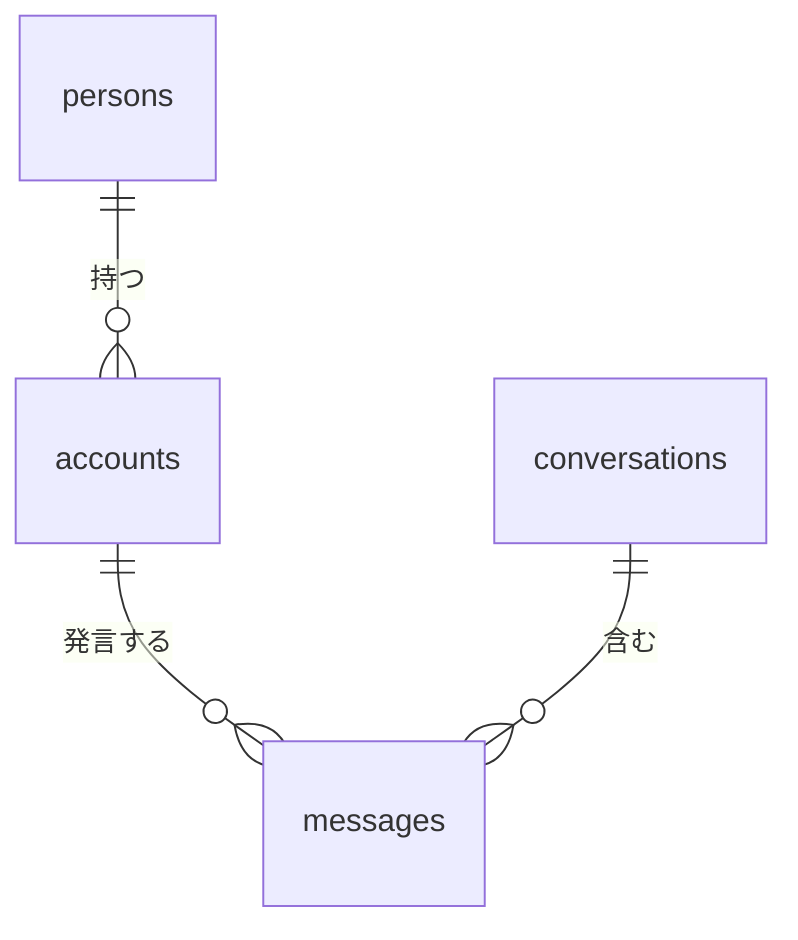

# 全体設計

## 人の識別モデル

Fairy は LINE などのアカウントではなく **「人間」** を識別する。

- LINE では `userId` や表示名などを手がかりに「この人間は誰か」を識別する。
- 音声や専用 UI など、ほかの環境でも同じように「この人間は誰か」を識別する。
- 別々の `Account` の人が同一人物かどうかは、**会話の流れから判断する**（[`Account` と `Person` の紐付け](#account-と-person-の紐付け)）。
- ただし **「誰がマスターで、誰が助手二号か」（`Role`）** だけは特別な情報として、オーナーが `Person` に設定する（[`Role`](#role)）。

### 概念モデル

- **`Person`**: Fairy が識別する 1 人の人間。
- **`Account`**: ある `Platform` での利用者のアカウント。LINE の 1 ユーザー、専用 UI のログインユーザーなどが該当する。1 人の `Person` が複数の `Account` を持つ。
- **`Platform`**: Fairy とやり取りする環境の種類。`line` / `web`（専用 UI）/ `voice`（iPad の音声）など。
  - LINE 以外の `Platform` で「アカウント」を何で表すか（専用 UI のログイン ID、音声なら端末や声紋など）は、その `Platform` を追加するフェーズで決める。**[未決]**
- **`Role`**: `Person` の属性。`master`（マスター）/ `assistant2`（助手二号）。ほとんどの `Person` は `Role` を持たない。

テーブル定義は [データモデル](#データモデル) を参照。

### `Account` と `Person` の紐付け

Fairy の処理（LLM）で `Account` と `Person` を紐付けると、返信に時間がかかる。そのため、Agent に渡す前に、`Account` から `Person` を引いておく（[全体アーキテクチャ](#全体アーキテクチャ) の MessageResolver）。

- 知らない `Account` から最初のメッセージが届いたら、`Person` も一緒に作る。この `Person` は、あとで既存の `Person` と同じ人だと分かったら、既存の `Person` に結合することがある。
- 同じ人だと分かったときの結合（2 つの `Person` を 1 人にまとめること）は、2 つ目の `Platform` を追加する Phase 5 で決める。**[未決]** MVP は LINE だけなので、結合は起きない。
  - 案: マスターか助手二号から「同じ人だ」という承認を得てから結合する。
  - 結合では、`Account` の付け替えだけでなく、暫定の `Person` について Fairy が覚えたこと（呼び名や関係）もまとめる必要がある。

### `Role`

`Role` は `Person` の属性として、D1 に持つ（`persons.role`）。発言者の `Role` は、`Account` から `Person` を引けば分かる。

- `Role` は、オーナーが SQL で設定する。マスター・助手二号も、最初のメッセージで `Person` が作られる。`Role` を設定するまでは、Fairy にとって「まだ知らない人」として扱う。**[MVP]**
- `Role` は D1 だけに持ち、設定値には持たない。`Role` は `Person` のものなので、`Account` の ID を設定値に書くと、`Platform` ごとに ID を書く必要があり、判定も `Account` を経由した回り道になるため。D1 だけに持つので、設定値と食い違う心配もない。
- 別の `Platform` の `Account` が同じ `Person` に結合されれば、その `Account` からの発言も同じ `Role` の人の発言になる。
- 誰と会話するか（受け付ける DM の相手やグループ）は、`Role` とは別に、Platform Adapter の設定値で持つ（[全体アーキテクチャ](#全体アーキテクチャ)）。「Fairy と会話できるか」はアクセスの制御で、「Fairy にとって誰か」とは別の関心事なため。

### Fairy が覚える人の情報

Fairy が人について持つ情報（呼び名、どういう人か、人と人の関係）は、**Fairy の目線のもの** で、Fairy が会話を通じて覚える。開発者やオーナーが直接書き込むことは想定しない。

- 例外は `Role`（マスター・助手二号）だけで、これはオーナーが設定する（[`Role`](#role)）。Fairy から見たマスター・助手二号の位置づけは [`FAIRY.md`](../FAIRY.md) に書く。
- 関係には、Fairy から見た各人だけでなく、**各人から見た Fairy やほかの人** も含む（例: `Person` 1 にとって Fairy や `Person` 2 はどういう存在か）。誰が誰にとってどういう存在かが分からないと、Fairy の発言として自然にならないため。
- LINE の表示名など、プラットフォーム上の名前は Fairy にとっての正しい呼び名とは限らない。呼び名を確かめるには、本人と話すしかない。
- `Person` は家族に限らず増えていくので、人の情報は D1 に持つ。人や組み合わせごとに増やせて、Fairy（Agent）が書き込めるため。リポジトリは公開しているので、実在の人の情報はリポジトリに置かない。
- 覚える仕組みとデータモデルは、長期記憶（Phase 3）と合わせて決める。**[未決]**（[後のフェーズで決めること](plan.md#後のフェーズで決めること)）

## 全体アーキテクチャ

### 3 つのレイヤーに分ける

Fairy を AI Agent として育てていくと、LINE・専用 UI・音声のどこから話しかけられても、同じ「頭脳」（プロンプトの組み立て、LLM 呼び出し、記憶、ツール実行）が使われる必要がある。そのため、コード上で次の 3 つのレイヤーに分ける。

| レイヤー | 受け持つこと | 次のレイヤーへの出力 |
| --- | --- | --- |
| Platform Adapter | `Platform` 固有の処理（LINE なら署名検証・受け付け判定・イベントの変換・Reply API での送信）。`Platform` ごとにある | `PlatformMessage`: `Platform` に依存しない形にそろえたメッセージ。中身の ID は `Platform` のもの |
| MessageResolver | `Account` から `Person` を引き（なければ作る）、会話の場を解決し、受け取ったメッセージを保存する | `ResolvedMessage`: `Account`・`Person`（`Role` を含む）・会話の場を解決したメッセージ |
| Agent | `Platform` に依存しない会話処理（履歴・プロンプト・LLM・再生成の制御）。Durable Object `ConversationAgent` | `Reply`: 返信の内容。返信しないときは返さない |

- 受け付け判定（誰と会話するか）は、Platform Adapter の責任にする。受け付ける会話は、Platform Adapter の設定値で持つ（[設定値](phases/phase-1.md#設定値)）。D1 を引かずに判定できるので速く、受け付けない入力を早い段階で捨てられる。
- MessageResolver は、Agent への入り口の関数の中で、Worker で動かす（ConversationAgent を呼ぶ前）。Platform Adapter は、どの `Platform` でも同じ入り口を呼ぶだけで済み、Agent は解決済みの入力を受け取るだけで済む。
- メッセージを保存するレイヤーは、誰の発言かで分ける。
  - 人の発言（受け取ったメッセージ）は MessageResolver で保存する。再送の検知もここで行い、再送されたメッセージなら Agent を呼ばずに終える。
  - Fairy の発言は Agent で保存する。Fairy から話しかけるとき（Phase 4）は、受け取ったメッセージがないので MessageResolver を通らない。また、同じ会話の処理が集まる Agent で保存すれば、保存中の Fairy の発言が終わってから次の生成を始められ、履歴の順番を守れる。

- デプロイ単位は **1 つの Worker（`fairy`）** にする。Worker を分けても、家庭用の規模では独立デプロイ・個別スケールなどの具体的なメリットがないため。分ける必要が出てきたら、そのときに切り出す（Durable Object は別 Worker からもバインディングで呼べる）。
- `Platform` が増えたら、Platform Adapter を足す（例: `/webhook/line`、`/ws` などのルート）。
- Agent は返信の送り方を知らない。返信の送信（Reply API / Push API / WebSocket など）は `Platform` ごとの Platform Adapter が担う。

### Durable Object を使う理由

**実現したいこと**: 同じ会話の中で、「回答の生成中に新しいメッセージが届いたら、進行中の生成を止め、最新の履歴で生成し直す」こと。

**Worker だけでは難しい理由**: Webhook は 1 回ごとに独立したリクエストとして処理され、リクエスト同士でメモリを共有できない。m2 を処理しているリクエストからは、m1 を処理しているリクエストの存在も、その LLM 呼び出しも見えない。D1 にフラグを書いてポーリングする方法も考えられるが、ロックの競合や遅延の扱いが複雑になる。

**Durable Object が有用な点**:

| 特徴 | この設計での使い道 |
| --- | --- |
| ID ごとに世界で 1 つのインスタンスになる | 会話（groupId / DM の userId）ごとに 1 つにすれば、同じ会話のイベントが必ず同じ場所に集まる |
| インスタンスがメモリ上の状態を持てる | 「生成中かどうか」「最後に受け取ったメッセージ」「進行中のリクエストの `AbortController`」を持てるので、新着が来たらその場で中断・再生成できる |
| 処理が直列化される | 同じ会話で複数の返信が同時に作られて競合することがない |
| （将来）Alarms / WebSocket | 自発的な話しかけのタイマー（Phase 4）、iPad の専用 UI との常時接続（Phase 5〜7）にも使える |

### Cloudflare のプラン

Workers Paid で動かす。オーナーの Cloudflare アカウントがすでに Workers Paid を使っていて、プランはアカウント単位で決まるため。Workers Free との違いは [Cloudflare Workers のプランの比較](comparison/cloudflare-plans.md) にまとめている。

### Agent フレームワークとして Cloudflare Agents SDK を最初から最小限使う

MVP 自体は OpenAI の SDK だけでも作れるが、機能追加（MCP によるツール連携、リマインドのスケジュール実行、専用 UI との常時接続）のときにはほぼ確実にフレームワークが必要になる。後から載せ替えるより、最初から最小限使っておく。

候補と比較（2026-11 時点の公開情報で確認）:

| 観点 | Cloudflare Agents SDK (`agents`) | Mastra |
| --- | --- | --- |
| Durable Object との関係 | Agent クラス自体が Durable Object。本設計の `ConversationAgent` をそのまま Agent クラスで作れる[^agent-class] | Durable Object は主にストレージのアダプター（`CloudflareDOStorage`）として使う[^mastra-cf-storage][^mastra-changelog] |
| MCP | MCP クライアント機能を内蔵（HTTP / Workers RPC で接続。MCP 2026-07-28 仕様に対応）[^agents-mcp-client][^agents-v060][^agents-mcp-2026] | MCP クライアント機能あり |
| 将来の機能 | スケジュール実行（Phase 4）、WebSocket・状態同期（Phase 5〜7）[^agents-repo] | ワークフロー・メモリ・評価などの機能が豊富 |
| 本設計との相性 | 「生成中の新着で中断・再生成」を Durable Object 上で自前制御する設計とそのまま噛み合う | Mastra 側の Agent 実行・メモリ管理と、自前の制御との合わせ込みが必要 |

- **Cloudflare Agents SDK を採用し、MVP では `ConversationAgent` を Agent クラスで作るところまでにとどめる**。**[MVP]** MCP・スケジュールなどは使う機能が必要になったフェーズで使い始める。
- LLM の呼び出しは、**AI SDK（`ai` + `@ai-sdk/openai`）で OpenAI に直接送る**。候補の比較は [LLM の呼び出し方法の比較](comparison/llm-invocation.md) にまとめている。
  - 要件（Workers で動く、Structured Outputs、`AbortSignal` での中断、reasoning effort の指定）をすべて公式ドキュメントで確認できたのは、OpenAI に直接送る組み合わせだけだった。
  - そのうち AI SDK は、Agents SDK の MCP クライアント（`getAITools()`）とそのままつながり[^cf-agents-mcp-client]、provider を差し替えれば OpenAI 以外のモデルも同じ書き方で呼べる[^ai-sdk-openai]。
  - Cloudflare AI Gateway は経由しない。**[MVP]** 経由した場合に、strict の構造化出力・reasoning effort の指定が OpenAI まで届くか、中断が伝わるか、`gpt-6-luna` を使えるかが、ドキュメントで確認できないため。MVP ができたら、実際に呼んで確かめたうえで改めて検討する（[後のフェーズで決めること](plan.md#後のフェーズで決めること)）。
  - OpenAI の strict モードの構造化出力では、スキーマに optional なプロパティを使えない（`.nullable()` で表す）[^ai-sdk-openai]。
  - AI SDK は、モデルを文字列で指定すると既定で Vercel の AI Gateway を経由する[^ai-sdk-openai]。Vercel のサービスは使わない（[コンセプト](concept.md#制約) の「クラウドを使うときは Cloudflare の製品を前提にする」）ので、`createOpenAI` で作ったモデルを渡す。

### 開発ツールとライブラリ

| 用途 | 使うもの |
| --- | --- |
| リポジトリの構成 | pnpm workspace の monorepo。Worker `fairy` は `packages/fairy` に置く |
| パッケージマネージャー | pnpm（依存のバージョンはすべて固定する） |
| lint / format | oxc（oxlint / oxfmt） |
| TypeScript の設定 | ルートの tsconfig で `@tsconfig/strictest` を継承し、各パッケージの tsconfig はルートの tsconfig を継承する。TypeScript もルートで管理する |
| テスト | Vitest + `@cloudflare/vitest-plugin`（Workers のランタイム上で、D1・Durable Object を含めてテストする） |
| HTTP のルーティング | Hono |
| LINE Messaging API の呼び出し | 自前で `fetch` を使って実装する（署名検証・Reply API）。型だけ `@line/bot-sdk` のものを使う |
| D1 へのアクセス | Drizzle ORM（マイグレーションは drizzle-kit で生成し、wrangler で適用する） |

## データモデル

D1 に保存する。

### `persons`（人間）

| カラム | 型 | 説明 |
| --- | --- | --- |
| `id` | TEXT (PK) | Fairy の内部で使う `Person` の ID |
| `name` | TEXT NULL | Fairy が会話を通じて覚えた呼び名 |
| `notes` | TEXT NULL | Fairy が覚えた情報。**[MVP]** 長期記憶を実装するまでの仮置き |
| `role` | TEXT NULL | `Role`。`master` / `assistant2`。オーナーが設定する。`Role` のない `Person` は NULL（[`Role`](#role)） |
| `created_at` | TEXT | 作成日時 |
| `updated_at` | TEXT | 更新日時 |

### `accounts`（アカウント）

| カラム | 型 | 説明 |
| --- | --- | --- |
| `id` | TEXT (PK) | Fairy の内部で使う `Account` の ID |
| `platform` | TEXT | `line` / `web` / `voice` など |
| `platform_user_id` | TEXT | **`Platform` 側でのユーザーの ID**。LINE なら `userId`（`U` で始まる文字列）。`id` は Fairy の内部で使う ID で、こちらは `Platform` から届く ID なので別物。`(platform, platform_user_id)` で一意 |
| `display_name` | TEXT NULL | プラットフォーム上の表示名（LINE のプロフィール名など） |
| `person_id` | TEXT (FK) | 紐付く `Person` |
| `linked_by` | TEXT | `Person` への紐付け方。`auto`（自動作成）/ `fairy_inference`（Fairy が会話から判断） |
| `created_at` | TEXT | 作成日時 |

### `conversations`（会話の場）

| カラム | 型 | 説明 |
| --- | --- | --- |
| `id` | TEXT (PK) | Fairy の内部で使う会話の ID |
| `platform` | TEXT | `line` など |
| `platform_conversation_id` | TEXT | `Platform` 側の会話の ID。LINE のグループなら `groupId`、DM なら相手の `userId`。`(platform, platform_conversation_id)` で一意 |
| `type` | TEXT | `group` / `dm` |
| `label` | TEXT NULL | `family` など、会話の場の用途 |
| `created_at` | TEXT | 作成日時 |

### `messages`（メッセージ）

| カラム | 型 | 説明 |
| --- | --- | --- |
| `id` | TEXT (PK) | Fairy の内部で使うメッセージの ID |
| `conversation_id` | TEXT (FK) | どの会話の場のメッセージか |
| `account_id` | TEXT (FK) NULL | 発言者。Fairy 自身の発言は NULL |
| `type` | TEXT | `text` / `sticker` など |
| `text` | TEXT NULL | 本文。スタンプはキーワードを入れる |
| `payload_json` | TEXT | 元のイベント（将来の再解析に使う） |
| `platform_message_id` | TEXT NULL | `Platform` 側のメッセージ ID（重複受信の検知に使う）。`(conversation_id, platform_message_id)` で一意 |
| `created_at` | TEXT | 送信日時 |

[^agent-class]: [Agent class internals](https://developers.cloudflare.com/agents/concepts/agent-class/)
[^mastra-cf-storage]: [Mastra: Cloudflare Storage](https://mastra.ai/reference/storage/cloudflare)
[^mastra-changelog]: [Mastra Changelog 2026-03-12](https://mastra.ai/blog/changelog-2026-03-12)
[^agents-mcp-client]: [MCP Client API](https://developers.cloudflare.com/agents/model-context-protocol/apis/client-api/)
[^agents-v060]: [Agents SDK v0.6.0](https://developers.cloudflare.com/changelog/post/2026-02-25-agents-sdk-v0.6.0/)
[^agents-mcp-2026]: [Agents SDK adds MCP Specification 2026-07-28 support](https://community.cloudflare.com/t/agents-workers-agents-sdk-adds-mcp-specification-2026-07-28-support/943386)
[^agents-repo]: [cloudflare/agents (GitHub)](https://github.com/cloudflare/agents)
[^cf-agents-mcp-client]: [Agents: MCP Client API](https://developers.cloudflare.com/agents/model-context-protocol/apis/client-api/)
[^ai-sdk-openai]: [AI SDK Providers: OpenAI](https://ai-sdk.dev/providers/ai-sdk-providers/openai)
