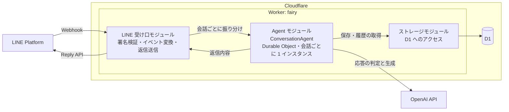
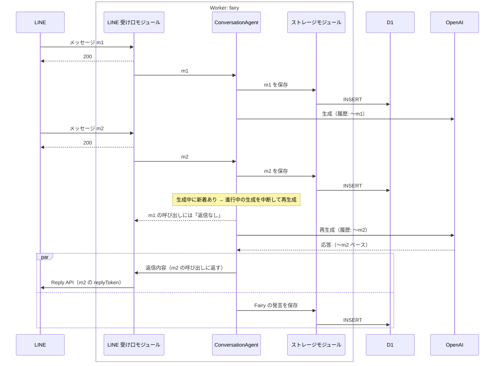

# Phase 1 (MVP) の詳細設計

フェーズをまたいで使う設計は [全体設計](../design.md) を参照。

## 要件

- Fairy は LINE の **家族グループ** と、**マスター・助手二号との DM** でだけ会話する（詳細は [会話の受け付け判定](#会話の受け付け判定)）。
- 会話に投稿された **すべてのメッセージを LLM で判定し**、応答が必要なときだけ返信する。
- 家族同士のやり取りも保存し、文脈として参照してよい。
- 扱う入力はテキストとスタンプ。**[MVP]**
- 記憶は短期（直近の会話履歴）のみ。**[MVP]** ただし長期記憶を後から追加できる構造にしておく。
- 会話ログは **無期限で保存** する（将来の長期記憶の素材にする）。
- Fairy の回答が完了する前に新しいメッセージが届いたら、**そのメッセージも踏まえて回答する**。

## 構成



| 要素 | 役割 |
| --- | --- |
| Worker (`fairy`) | デプロイ単位。以下のモジュールを含む |
| └ LINE 受け口モジュール | LINE とのやり取り（[LINE 受け口モジュールの処理フロー](#line-受け口モジュールの処理フロー)） |
| └ Agent モジュール (`ConversationAgent`) | Agents SDK の Agent クラス（Durable Object）。会話（グループや DM）ごとに 1 インスタンス（[ConversationAgent の処理フロー](#conversationagent-の処理フロー)） |
| └ ストレージモジュール | D1 への読み書きをまとめる |
| D1 | Person / Account / 会話 / メッセージを保存する（[データモデル](../design.md#データモデル)） |

## LINE 受け口モジュールの処理フロー

1. Webhook を受け取って署名 (`x-line-signature`) を検証し、すぐに 200 を返す（以降の処理は `ctx.waitUntil` で行う）。署名が正しくなければ 401 を返し、何もしない。
2. メッセージイベント以外（join / memberJoined / leave / memberLeft など）は無視する。**[MVP]**
   - Person / Account は、メッセージを受信したときに「なければ作る」（[基本の流れ](#基本の流れ)の 1）ので、最初に発言した時点で必ず登録される。一度も発言しない人は Fairy にとって識別する必要がない。
   - 家族グループの groupId もメッセージイベントの `source.groupId` から分かる。
   - メッセージイベントでも、テキストとスタンプ以外（画像・動画・音声・ファイル・位置情報など）は無視する。保存もしない。**[MVP]** 画像は Phase 2 で扱う。
   - 発言者の userId が含まれないイベントは、発言者を識別できないので無視する。
3. 会話を受け付けるかどうかを判定する（[会話の受け付け判定](#会話の受け付け判定)）。受け付けない会話は破棄する。
4. 会話の ID（groupId または DM 相手の userId）に対応する ConversationAgent にイベントを渡す。
5. ConversationAgent から返信内容を受け取ったら、Reply API で送る。「返信なし」を受け取ったら何もしない（[生成中に新しいメッセージが届いた場合](#生成中に新しいメッセージが届いた場合)）。
   - Push API は無料で送れる通数に上限があるため、MVP では使わない。**[MVP]**

## ConversationAgent の処理フロー

### 基本の流れ

1. **送信者の Account / Person を解決する**。D1 になければその場で作成する。
   - 表示名（`accounts.display_name`）は取得せず、空のままにする。**[MVP]** LINE の表示名が、Fairy にとっての正しい呼び名とは限らないため。呼び名は会話を通じて覚える（`persons.name`）。知らない人の LINE の表示名を Fairy が調べる手段は、後のフェーズで検討する（[後のフェーズで決めること](../plan.md#後のフェーズで決めること)）。
2. **受信したメッセージを D1 に保存する**。スタンプは `packageId` / `stickerId` と、Webhook に含まれる場合は `keywords` を保存し、LLM にはキーワードをテキストとして渡す。
   - 同じメッセージ（同じ会話で `platform_message_id` が同じもの）をすでに保存していたら、Webhook の再送などとみなし、返信せずに終える。同じメッセージに二重に返信しないため。
3. 直近 N 件の会話履歴・`FAIRY.md`・人の情報からプロンプトを作る（[プロンプトでの人の表し方](#プロンプトでの人の表し方)）。
4. LLM に **応答の要否と応答文を 1 回の呼び出しで** 出力させる（Structured Outputs、例: `{ should_reply: boolean, reply: string }`）。判定と生成を別々に呼ぶより呼び出し回数が少なく、コストを抑えられる。
   - LLM の呼び出しにはタイムアウトを設ける（設定値 `OPENAI_TIMEOUT_SECONDS`、[設定値](#設定値)）。タイムアウトしたら返信せず、エラーをログに残す。
   - LINE 受け口モジュールが `ctx.waitUntil` で処理を延ばせるのは、レスポンスを返してから最大 30 秒。その中に LLM 以外の処理（Account の解決、保存、Reply API など）も入るので、タイムアウトは 25 秒にして 5 秒の余裕を残す。Cloudflare に打ち切られるとログを残せないため、その前に自分で打ち切る。
5. `should_reply` が true なら、返信内容を LINE 受け口モジュールに返して Reply API で送ってもらう。返すのと並行して、Fairy の発言を D1 に保存する（[応答速度と D1 への保存のタイミング](#応答速度と-d1-への保存のタイミング)）。

### プロンプトでの人の表し方

会話の履歴では、発言者を短い ID で表し、ID と人の対応は別の欄に一度だけ書く。

```
## この会話にいる人
- P1: マスター
- P2: 助手二号
- P3: Fairy がまだ知らない人

## 会話の履歴
[P1] おはよう
[P2] 今日って燃えるゴミの日だっけ
[Fairy] 肯定。本日は燃えるゴミの収集日です。
```

- ID（`P1`、`P2`…）はプロンプトを作るたびに振る。Person の ID をそのまま使うより短く、トークンが少なくて済む。
- 発言者を ID で表すのは、同じ人の発言を LLM が取り違えないようにするため。対応を別の欄にまとめておけば、人の情報が変わっても直すのはその欄だけで済む。
- 人の欄には、分かっていることだけを書く。Phase 1 では Fairy は人の情報を覚えないので（[Fairy が覚える人の情報](../design.md#fairy-が覚える人の情報)）、書けるのは役割だけになる。**[MVP]**
  - 設定値と一致する人: 「マスター」「助手二号」
  - それ以外の人: 「Fairy がまだ知らない人」
- 返信は、LLM が呼び名を使って直接書く。返信の中では ID で人を表し、あとで呼び名に置き換える方式（二段構成）にはしない。
  - LLM は返信を書くときに、相手がマスターかどうかなどを知っている必要がある（`FAIRY.md` は相手によってふるまいを変える）。そのため、どちらの方式でも ID と呼び名の対応をプロンプトに入れることになり、置き換える段を足しても得るものがない。
  - 置き換える段を足すと、LLM が置き換え用の書式を崩したときや、呼び名を知らない人のときの扱いを決める必要が出てくる。

### 生成中に新しいメッセージが届いた場合

ConversationAgent は「生成中かどうか」と「最後に受け取ったメッセージ」を記録している。生成中に新しいメッセージが届いたら、**進行中の生成を中断し、最新の履歴で生成し直す**。



- 返信は、**再生成のきっかけになった最新のメッセージの呼び出し** が送る。中断された生成を待っていた呼び出し（上の図の m1）は、「返信なし」を受け取って終わる。
  - こうすると、LINE 受け口モジュールのどの呼び出しも、待つのは 1 回分の生成時間だけになる。`ctx.waitUntil` で処理を延ばせるのはレスポンスを返してから最大 30 秒なので、再生成が続いてもこの時間に収まる。
- 返信には **最新のメッセージの replyToken** を使う（replyToken はメッセージイベントごとに発行される）。
  - 再生成のきっかけは常に新着メッセージなので、返信に使う replyToken は「最後のメッセージを受け取ってから 1 回分の生成時間」しか経っていない。そのため、再生成が続いても replyToken が古くなることはない。
- 中断は、進行中の OpenAI へのリクエストを `AbortController` で止めて行う。応答を待ってから捨てるより待ち時間が短い。
- 再生成の回数には上限を設ける（設定値 `MAX_REGENERATIONS`、[設定値](#設定値)）。上限は大きめにし、通常は達しない想定。
  - 上限に達したあとに届いたメッセージは、進行中の生成を中断しない。保存だけして、その呼び出しは「返信なし」で終わる。
  - 進行中の生成の返信は、その生成を始めた呼び出しが送る。
  - 上限に達したときの振る舞いは、実装が単純になることを優先している。上限に達したあとに届いたメッセージは、その返信には反映されない。

### 応答速度と D1 への保存のタイミング

応答速度への影響が最も大きいのは LLM の呼び出し（数秒）で、D1 への書き込みは数〜数十ミリ秒程度と見込んでいる。そのため次のようにする。

- **受信メッセージは LLM を呼ぶ前に保存する**。上の「生成中の新着」の検知と再生成には最新の履歴が必要なこと、LLM の呼び出しが失敗してもログが残ることが理由。
- **Fairy の発言は、返信内容を受け口に返すのと並行して保存する**（Durable Object の `waitUntil` で行い、応答時間に影響しない）。返信を送るのは受け口なので、Agent には送れたかどうかが分からない。そのため、Reply API での送信に失敗しても、Fairy の発言は履歴に残る。
- 1 と 2（Account の解決とメッセージの保存）と履歴の取得は、並列にできる部分は並列に行う。
- さらに速くする必要が出てきたら、直近の履歴を Durable Object 内にキャッシュし、D1 からの読み出しを省く。

## 会話の受け付け判定

| 会話の種類 | 扱い |
| --- | --- |
| 家族グループ（設定値の groupId と一致） | 受け付ける |
| マスター・助手二号との DM | 受け付ける |
| それ以外の人との DM | 応答しない。保存もしない |
| 家族グループ以外のグループ・複数人トーク | 退出はせず、応答しない。保存もしない。**[MVP]** 将来は `conversations` テーブルで受け付けるグループを管理できるようにする（管理方法は **[未決]**） |

## LLM のモデルと会話履歴の件数

**[MVP]** 値は設定値で変えられるようにする（[設定値](#設定値)）。

| 項目 | 値 |
| --- | --- |
| モデル | `gpt-6-luna` |
| reasoning effort | `none`（応答速度とコストを優先。応答の質が足りなければ `low` に上げる） |
| 会話履歴の件数 N | 30 件 |

**モデルを `gpt-6-luna` にする理由**（2026-11-22 時点の OpenAI 公式ページで確認[^openai-pricing][^openai-models][^openai-deprecations]）

- 単価が最も安い `gpt-5-nano` は数週間後に提供終了するため、現行モデルで最も安い `gpt-6-luna` を選ぶ。

  | モデル | 入力 / キャッシュ入力 / 出力（1M トークンあたり） | 状態 |
  | --- | --- | --- |
  | `gpt-5-nano` | $0.05 / $0.005 / $0.40 | 2026-12-11 に提供終了。後継は `gpt-6-luna` |
  | **`gpt-6-luna`** | **$0.10 / $0.01 / $0.50** | 現行。OpenAI が「最も効率的なモデル」としている |
  | `gpt-5.6-luna` | $0.20 / $0.02 / $1.20 | 現行 |
  | `gpt-5.4-nano` | $0.20 / $0.02 / $1.25 | 2027-04-01 に提供終了 |

- 画像入力にも対応しているため、Phase 2（画像の理解）でもモデルを変えずに済む見込み。
- Structured Outputs に対応している（モデルページの Supported features に `structured_outputs` がある）。reasoning effort に `none` も指定できる。[^openai-gpt-6-luna]

**コストの試算**（利用量は仮定）

- 1 回の呼び出し: 入力 約 4,000 トークン（`FAIRY.md` 約 2,000 + 履歴 30 件 約 1,500 + その他）、出力 約 150 トークンと仮定すると、約 $0.0005。
- 1 日 100 メッセージ（再生成を含む）なら、月 3,000 回で **約 $1.5（約 230 円）**。
- `FAIRY.md` などのプロンプトの先頭部分は毎回同じなので、キャッシュ入力の料金（通常の 1/10）が適用されれば、さらに安くなる。
- 予算（月 2,000 円）に対して十分に余裕がある。ただし、全メッセージを判定し、さらに再生成もあるため、利用量が想定より増えていないか監視する（監視方法は [後のフェーズで決めること](../plan.md#後のフェーズで決めること)）。

**会話履歴を 30 件にする理由**

- グループでは複数人の発言が入り混じるため、1:1 より多めに必要になる。30 件あれば、数人で何往復かした話題をひと通り含められる。
- 日本語の短い発言なら 30 件で 1,000〜2,000 トークン程度で、コストへの影響は小さい。

## 設定値

種類の `vars` は Environment variables[^cf-env-vars]、`secrets` は Secrets[^cf-secrets] を指す。

| キー | 内容 | 種類 | 初期値 |
| --- | --- | --- | --- |
| `LINE_CHANNEL_SECRET` | LINE の Channel Secret（署名検証に使う） | secrets | — |
| `LINE_CHANNEL_ACCESS_TOKEN` | LINE の Channel Access Token（返信に使う） | secrets | — |
| `OPENAI_API_KEY` | OpenAI の API Key | secrets | — |
| `LINE_USER_ID_MASTER` | マスターの LINE userId | secrets | — |
| `LINE_USER_ID_ASSISTANT2` | 助手二号の LINE userId | secrets | — |
| `LINE_GROUP_ID_FAMILY` | 家族グループの groupId。**[MVP]** 受け付けるグループを `conversations` テーブルで管理するようになったら不要になる | secrets | — |
| `OPENAI_MODEL` | LLM のモデル（[LLM のモデルと会話履歴の件数](#llm-のモデルと会話履歴の件数)） | vars | `gpt-6-luna` **[MVP]** |
| `OPENAI_REASONING_EFFORT` | reasoning effort（[LLM のモデルと会話履歴の件数](#llm-のモデルと会話履歴の件数)） | vars | `none` **[MVP]** |
| `OPENAI_TIMEOUT_SECONDS` | LLM の呼び出しのタイムアウト（秒）（[基本の流れ](#基本の流れ)） | vars | `25` |
| `HISTORY_LIMIT` | プロンプトに入れる会話履歴の件数（[LLM のモデルと会話履歴の件数](#llm-のモデルと会話履歴の件数)） | vars | `30` **[MVP]** |
| `MAX_REGENERATIONS` | 再生成の回数の上限（[生成中に新しいメッセージが届いた場合](#生成中に新しいメッセージが届いた場合)） | vars | `10` **[MVP]** |

## FAIRY.md の取り込み

- [`FAIRY.md`](../../FAIRY.md) はリポジトリで管理し、ビルド時に文字列として Worker に取り込んでシステムプロンプトに使う。
- `FAIRY.md` 内の HTML コメント（`<!-- ... -->`）は、オーナーが内容の補足（出典・元のセリフなど）を書くためのもの。システムプロンプトに入れる前に取り除く。

[^openai-pricing]: [OpenAI API Pricing](https://developers.openai.com/api/docs/pricing)
[^openai-models]: [OpenAI Models](https://developers.openai.com/api/docs/models)
[^openai-deprecations]: [OpenAI Deprecations](https://developers.openai.com/api/docs/deprecations)
[^openai-gpt-6-luna]: [OpenAI Models: GPT-6 Luna](https://developers.openai.com/api/docs/models/gpt-6-luna)
[^cf-env-vars]: [Cloudflare Workers: Environment variables](https://developers.cloudflare.com/workers/configuration/environment-variables/)
[^cf-secrets]: [Cloudflare Workers: Secrets](https://developers.cloudflare.com/workers/configuration/secrets/)
